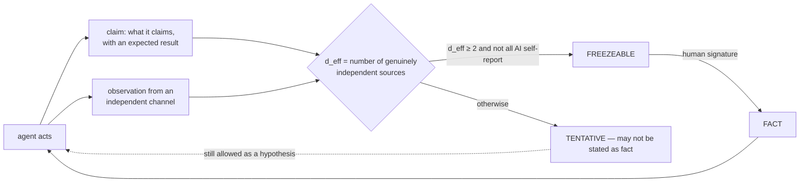

# Warrant

**An anti-black-box, anti-lag attestation layer for AI agents.**

> Every other project is racing to make agents smarter. Warrant answers a different question:
> **did it actually happen?** — and answers it in a way a third party can recompute from bytes.

`MIT OR Apache-2.0` · spec `warrant/1` (frozen) · 58 tests passing

---

## The two failure modes it exists to shrink

An agent that can act on a real machine creates two problems that no amount of intelligence fixes.

### 1. The black box

You cannot tell what actually happened.

- The agent says *"I wrote the file"* — you either believe it or read the logs afterwards.
- Three "independent confirmations" turn out to be **one** evidence source restated three times.
- Two agents, two sessions, two people cannot see what the other one did.

### 2. The lag

By the time you know, it is too late.

- The sentence was already said, the file already overwritten, the board already flashed.
- The rule *"don't claim what you cannot prove"* lives in a document **nobody was required to read**.
- The judgement rules changed, and old conclusions are read as if produced under the new ones.

Warrant is built around one blunt refusal:

> **The system may not say something out loud when the evidence is not there.**

---

## What it does



Three pieces, no more:

1. **A chained, append-only ledger.** Every entry carries a canonical id and a `chain.prev` pointer. Change one byte and the chain breaks.
2. **Evidence axes with a dimensionality gate.** `d_eff = rank(M)` is the number of *genuinely independent* sources behind a claim; `n − d_eff` is exactly where hallucination lives — three citations that are really one.
3. **A gate at the exit, plus human freeze.** `d_eff ≥ 2` **and** at least one non-AI axis ⇒ `FREEZEABLE`. Only a human signature turns that into `FACT`.

### The four axes

| Axis | Meaning | Who can fake it |
|---|---|---|
| **A** | System log — *our own* out-of-process read-back / offline recomputation | requires changing the outside world |
| **B** | The controlled software's own self-report (verify read-back) | the controlled software |
| **C** | A human signature | requires the private key |
| **D** | AI self-report (same-session tool receipt) | **the AI itself** — so it never counts toward the gate |

### Why the counters can be trusted

| Mechanism | What it removes |
|---|---|
| **Closed probe set** (`file.sha256`, `file.stat`, `dir.count`, `json.field`, `cmd.exit`) | the agent may *select* a probe and its arguments, but **cannot submit measurement code**; `cmd.exit` never returns stdout |
| **MCP proxy, on by default** | the agent can only talk through the proxy; every `tools/call` is recorded automatically — it cannot opt out |
| **Offline recomputation** | anyone holding `entries.jsonl` plus this repo reproduces the same verdict (`warrantd verify`) |
| **Trust anchor** | a cryptographically valid signature from an *unregistered* key is rejected — a self-made key proves nothing |
| **RULESET_VERSION bound into each snapshot** | judgements made under different rules cannot be silently mixed |

---

## Quick start

```bash
cargo test                                # 58 tests: conformance C1–C13, chain, signatures, probes, proxy
cargo run --example make_sample_ledger    # reproducible sample ledger (106 lines / 96 dedup / 0 chain errors)
```

Record an action, observe it twice, and let the gate decide:

```bash
warrantd capability --root .warrant --actor agent:demo --caps write_file

warrantd act --root .warrant --actor agent:demo --expect '{"path":"out.txt","bytes":13}'
# → {"ok":true,"id":"sha256:..."}

# Axis A — a real measurement performed by warrantd, not by the agent
warrantd observe --root .warrant --subject sha256:... --channel proc_spawn_readback --tier C1 \
  --probe file.sha256 --arg path=out.txt

# Axis B — the controlled software's own read-back
warrantd observe --root .warrant --subject sha256:... --channel mcp_verify_readback --tier C1 \
  --result '{"path":"out.txt","bytes":13}'

warrantd status --root .warrant
# → {"claims":[{"state":"CONSISTENT","label":"FREEZEABLE","d_eff":2}]}
```

Python — three lines; other languages use the same stdio protocol:

```python
from warrant import Warrant
w = Warrant(".warrant")
claim = w.act({"path": "out.txt", "bytes": 13})
w.observe(claim, "proc_spawn_readback", {"path": "out.txt", "bytes": 13}, tier="C1")
print(w.label(claim))          # FREEZEABLE / TENTATIVE
```

Turn `FREEZEABLE` into a fact with a human key registered as a trust anchor:

```bash
warrantd keygen --out ~/warrant-human.key.json
warrantd trust  --root .warrant --key-id ed25519:<hex>     # must be run by a human
warrantd freeze --root .warrant --claim sha256:... --key ~/warrant-human.key.json --signer user:me
# → state: WARRANTED
```

Put it *in the middle* so it cannot be skipped:

```bash
warrantd mcp-proxy --root .warrant --upstream "python my_mcp_server.py" \
  --probe file.sha256 --arg path=artifact.bin
```

Cross-host: each machine keeps its own chain; aggregate only counts axes.

```bash
warrantd aggregate /mnt/a/.warrant /mnt/b/.warrant
```

---

## What Warrant does **not** do (honest boundaries)

- **It does not judge content.** It counts how many independent sources saw something, not whether what they saw makes sense. Content can lie; the number of axes is harder to.
- **It does not guarantee correctness.** A frozen fact can still be wrong. It guarantees that *insufficiently evidenced statements have no authority*.
- **It cannot help a single-source, self-certifying, non-recomputable setup.** That is precisely what it was not built for.
- **Probes prove the measurement, not the target.** If the caller supplies the path, it can point a probe at a decoy it just created — pin the target in host configuration for the stronger guarantee.
- **The proxy assumes serial requests.** MCP permits concurrency; for concurrent clients run one proxy per request.

## Status

| Item | State |
|---|---|
| Conformance C1–C13 | ✅ vectors in-repo, byte-for-byte |
| Adapter (3 primitives + status + verify) | ✅ `warrantd` CLI + stdio daemon |
| Human freeze | ✅ `keygen` / `trust` / `freeze`, Ed25519 |
| Unforgeable axis A | ✅ closed probe set (5 probes), `--exec` disabled by default |
| Default-on recording | ✅ `mcp-proxy` |
| Cross-host aggregation | ✅ `warrantd aggregate` |
| SDKs | Python ✅ · TypeScript ✅ · Go ⚠️ not compiled here |
| crates.io | ⏳ not published yet |

## Specification

`SPEC.md` (v1.0, **frozen**), `PROTOCOL.md` (why something qualifies), `ADAPTER.md` (how hosts plug in).
The executable definition is the spec text **plus** `vectors/*.json`; the test suite fails rather than skips when a fixture is missing.

Additional documents (Chinese): [`README.zh.md`](README.zh.md) · [`POSITIONING.md`](POSITIONING.md) · [`ADAPTER-SDK.md`](ADAPTER-SDK.md).

## License

- **Code**: `MIT OR Apache-2.0` — see `LICENSE-MIT` / `LICENSE-APACHE`.
- **Specification text**: **CC BY 4.0** (`LICENSE-DOCS.md`) — reuse with attribution.
- **Name and marks**: "Warrant" and the project mark are not granted by the licenses above.
  Please do not call a fork the official implementation; claim conformance by running `cargo test` and citing the vector version.

---

> **Intelligence has a ceiling set by model vendors. "Did it actually happen" has no vendor.
> Warrant is that layer: lag compressed into the current turn, the black box reduced to a number of axes.**
